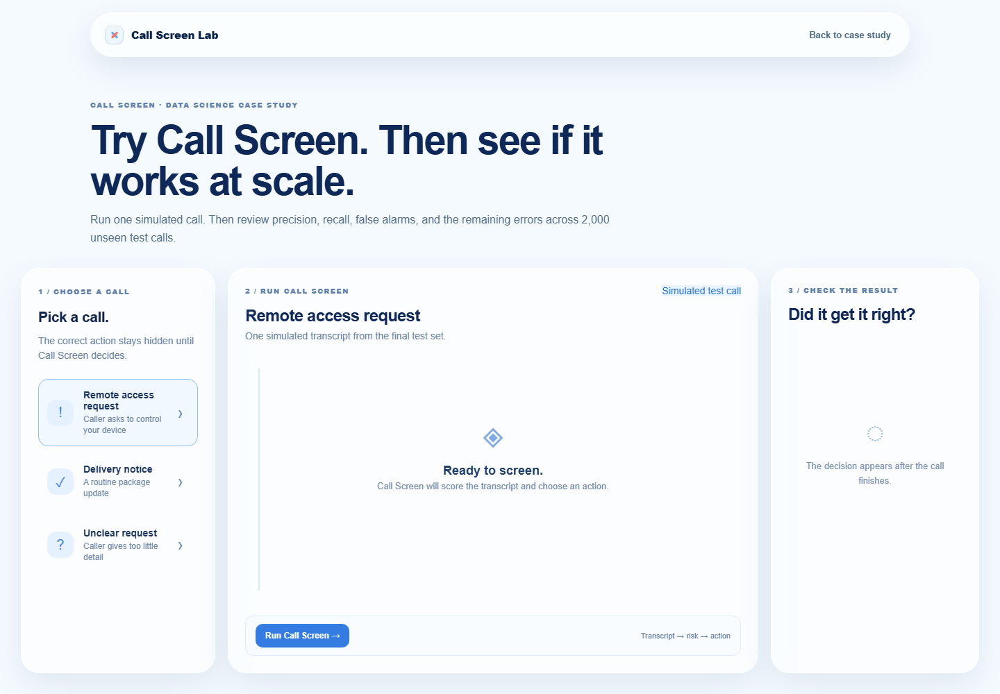
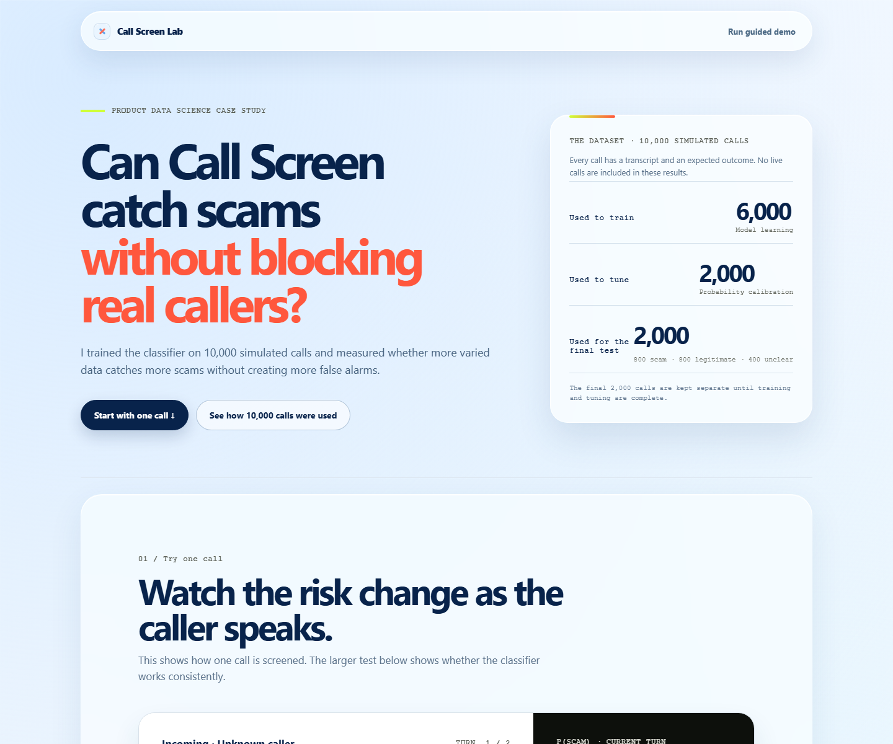

# Call Screen Lab

A product data science case study for scam-call screening: catch harmful calls without blocking legitimate callers.

**Public demo:** https://kulkshan.github.io/ai-call-screen/

**68-second video:** https://kulkshan.github.io/ai-call-screen/call-screen-lab-demo.mp4

**90-second tour:** [docs/RECRUITER_WALKTHROUGH.md](docs/RECRUITER_WALKTHROUGH.md)

## Preview





## What to try

1. Run a simulated call through Call Screen.
2. Compare its decision with the expected label.
3. Review performance across 2,000 unseen test calls.

The demo connects one product decision to the full measurement story: precision, recall, false alarms, missed scams, unclear calls, and the errors that should guide the next iteration.

## How it works

`Transcript → trained classifier → scam probability → evidence check → action`

The action is one of:

- **ALLOW** — let the call continue.
- **CONTINUE SCREENING** — ask one focused follow-up.
- **WARN** — show a safety warning and keep screening.
- **BLOCK** — stop the call.

The code keeps signal extraction, transcript scoring, risk combination, and the decision policy separate so each part can be evaluated or replaced independently.

## Evaluation data

The project uses **10,000 simulated, labeled calls**:

- 6,000 for training
- 2,000 for probability calibration
- 2,000 for the final test

The final test contains 800 scam calls, 800 legitimate calls, and 400 intentionally unclear calls. Those calls are kept separate from training and tuning.

## Final simulated test

- **Precision:** 93.9%
- **Recall:** 98.8%
- **False-positive rate:** 6.4%
- **Scams caught:** 790 of 800
- **Legitimate calls incorrectly flagged:** 51 of 800
- **Unclear calls kept in screening:** 400 of 400, up from 84 of 400 with score-only decisions

These are simulated benchmark results. They do not estimate real-world Google Call Screen performance.

## Stack

- **Twilio ConversationRelay** for the working local voice flow
- **FastAPI** for call sessions, transcript processing, and model APIs
- **Our classifier** for transcript risk scoring
- **Next.js** for the guided demo and evaluation report
- **GitHub Pages** for the public recruiter demo

## Repository map

- `backend/` — FastAPI and the Twilio call flow
- `classifier/` — transcript model interface and trained model artifacts
- `signals/` — structured call and conversation signals
- `risk/` — deterministic risk combination
- `policy/` — action thresholds and the evidence check
- `eval/` — benchmark generation and evaluation
- `web/` — guided demo and case study
- `docs/` — architecture, evaluation method, cost model, and limitations

## Application materials

- [90-second recruiter walkthrough](docs/RECRUITER_WALKTHROUGH.md)
- [Résumé, LinkedIn, and interview copy](docs/APPLICATION_COPY.md)

## Run locally

Start the backend:

```powershell
cd backend
.\.venv\Scripts\python -m uvicorn main:app --host 127.0.0.1 --port 8002
```

Start the frontend in a second terminal:

```powershell
cd web
npm install
npm run dev -- --port 3001
```

Open http://127.0.0.1:3001/.

Copy `backend/.env.example` to `backend/.env` and add secrets locally. Never commit `.env`.

## What comes next

Before any rollout, repeat the evaluation with independently reviewed real transcripts, run the new classifier in shadow mode, and compare it with a holdout. Expand only if scam recall, false alarms, and latency all remain acceptable.
