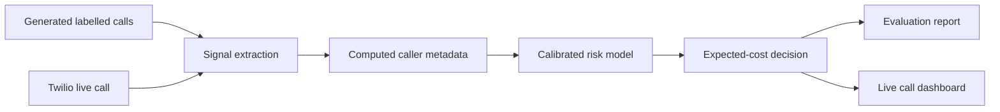

# Architecture

The evaluation harness and Twilio adapter use the same signal, fusion, and policy code. The harness supplies generated ground truth and calculated reporter/number history. A live call supplies Gemini transcript signals; a real reputation feed is not present and is marked unavailable.
